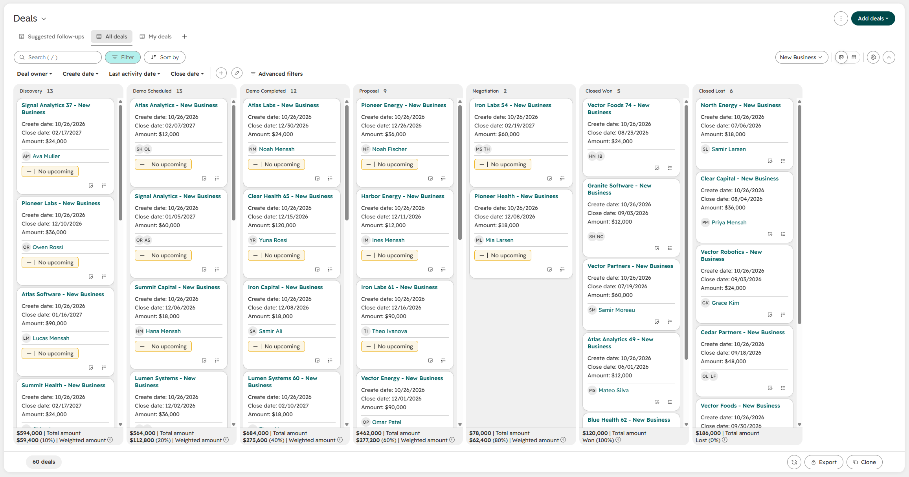

# HubSpot Portal-as-Code

**Define a HubSpot portal's CRM setup in one YAML file, preview every change, and apply it in one command.**

Setting up a HubSpot portal by hand means clicking through dozens of settings screens. Nothing records why a property exists, and nothing stops two portals from drifting apart. This project treats the setup the way engineers treat infrastructure: the config lives in Git, changes are reviewed as diffs, and a `plan` step shows exactly what will change before anything does.

<!-- TODO: add demo.gif — Claude Code running plan → apply → seed against a fresh test account -->

## What it manages

| | |
|---|---|
| **Property groups** | Contacts and deals |
| **Custom properties** | Text, date, number, checkbox and dropdown fields, including dropdown options and unique-value properties |
| **Deal pipelines** | Stages, their order and their win probabilities |
| **Seed data** | 300 fake contacts across 75 companies and 60 associated deals, for demos and testing |

It only touches what `portal.yaml` lists. HubSpot's default properties, other pipelines and existing records are left alone.

## How it works

```
portal.yaml ──► validate ──► plan (diff vs. live portal) ──► apply ──► seed
                 local         read-only                      writes    fake data
```

```console
$ python -m portal_as_code plan
  ~ property contacts.icp_tier
        options added: ['Strategic']
  + stage    deals.New Business / Security Review
  ~ stage    deals.New Business / Proposal
        position: 3 -> 4
  ...
Plan: 1 to create, 5 to update, 16 unchanged
```

**Design choices worth calling out**

- **Idempotent.** Running `apply` twice makes no changes the second time, and running `seed` twice updates records instead of duplicating them, because every seeded record is upserted on a unique `seed_key` property.
- **Safe by default.** It never deletes properties, pipelines or stages. Stages in HubSpot that aren't in the config are flagged as warnings. Changes HubSpot can't make safely, like changing a property's type, block `apply` with an explanation instead of failing halfway through.
- **Validated before any API call.** Typos, unknown groups, and pipelines without a closed-won or closed-lost stage are caught locally, and every problem is listed at once.
- **Ordered by dependency.** Groups are created before the properties that use them, and pipelines before their stages.
- **Rate-limit aware.** It retries on HTTP 429 using HubSpot's `Retry-After` header and backs off on server errors. A 403 tells you the token is missing a scope.
- **Drift detection for CI.** `plan --detailed-exitcode` exits with code 2 when the portal no longer matches the config.
- **No real data.** Seeded emails use subdomains of `example.com`, which is reserved for documentation, so nothing can be sent to a real address.
- **Readable errors.** A rejected batch can return thousands of characters of validation detail; errors are trimmed to the part you need.

## Quick start

**Requirements:** Python 3.10+, Node.js 18+ (for the HubSpot CLI), and a free [HubSpot developer account](https://developers.hubspot.com/).

```bash
# 1. Install
git clone https://github.com/shahmeerk-gtm/hubspot-portal-as-code.git
cd hubspot-portal-as-code
pip install -r requirements.txt

# 2. Create a developer test account (pick Sales Hub Professional so the account allows a second deal pipeline)
npm install -g @hubspot/cli@latest
hs account auth
hs test-account create

# 3. In the test account, go to Development > Keys > Service keys and create a key with:
#    crm.schemas.contacts.read/write, crm.schemas.deals.read/write,
#    crm.objects.contacts.read/write, crm.objects.deals.read/write
cp .env.example .env    # paste the token into .env

# 4. Run it
python -m portal_as_code validate
python -m portal_as_code plan
python -m portal_as_code apply
python -m portal_as_code seed
```

If your account allows only one deal pipeline, add `id: default` to the pipeline in `portal.yaml`, and the tool will manage HubSpot's built-in pipeline instead.

## Commands

| Command | What it does |
|---|---|
| `validate` | Checks `portal.yaml` without calling HubSpot |
| `plan [--all] [--detailed-exitcode]` | Shows what `apply` would change |
| `apply [--yes]` | Makes the portal match `portal.yaml` |
| `seed [--seed N] [--deals N]` | Upserts deterministic fake contacts and deals, with associations |
| `seed --export DIR` | Writes the seed data to CSVs instead of calling HubSpot |
| `clean-seed [--yes]` | Archives every seeded record (restorable in HubSpot for 90 days) |

## Working with Claude Code and the HubSpot MCP server

This repo is set up for AI-assisted development. [`CLAUDE.md`](CLAUDE.md) gives Claude Code the project's rules: only ever touch a test account, run `plan` before `apply`, and keep the tests passing.

To give Claude Code direct access to HubSpot's developer tools and docs, run `hs mcp setup` and choose Claude Code. Then, from inside the repo, you can ask things like:

- "Create a developer test account with Sales Hub Professional."
- "Add a Partner Referral option to lead source on contacts and deals, then show me the plan."
- "Search the HubSpot docs for the pipeline stages API and check our payload matches it."

## Project layout

```
portal.yaml                  the portal definition
portal_as_code/
  config.py                  loads and validates portal.yaml
  client.py                  HubSpot API client (auth, retries, every endpoint path)
  planner.py                 diffs config vs. live portal into a plan
  applier.py                 executes a plan in dependency order
  seed.py                    deterministic fake data, upsert, clean-up
  cli.py                     command line
tests/                       pytest suite against an in-memory fake HubSpot
```

## Tests

```bash
pip install pytest
python -m pytest
```

The suite runs against an in-memory fake of the HubSpot API that enforces the rules that matter here, such as requiring a property's group to exist and keeping unique values unique. It covers validation, plan output, apply ordering, idempotency, the seed round trip, rate-limit retries and the CLI. GitHub Actions runs it on every push.

## Notes from the first live run

- `plan` and `apply` worked against a real test account on the first try, and a second `plan` came back clean.
- `seed` failed on its first run: HubSpot's email validation rejects the reserved `.example` top-level domain, even though it's the textbook choice for fake data. Because the batch upsert is all-or-nothing, nothing partial was written. The fix was to switch to subdomains of `example.com`.
- The 400 response listed all 100 invalid emails in one message, which buried the actual cause. Errors are now trimmed to the first few hundred characters.

## What's next

- Lifecycle stage definitions and lead status options
- Company and ticket objects
- Workflows, which need HubSpot's automation API and a paid tier
- An attribution report built on the seeded data
